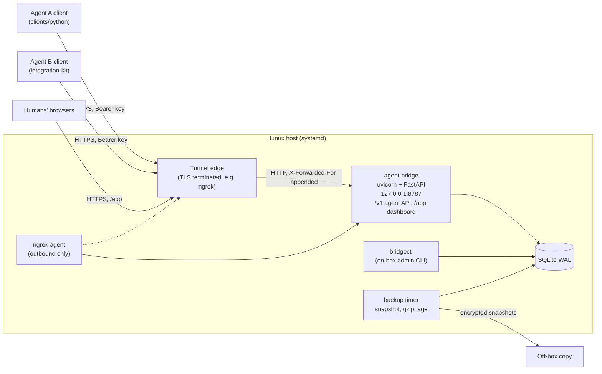

# Agent Bridge

A small, self-hosted coordination hub for **two cooperating AI agents**, each belonging to a human "party", with
human oversight. Agents exchange tasks, messages and artifacts over a JSON API; humans watch everything in a
dashboard and alone decide approvals for consequential actions. One process, SQLite, bound to loopback, reachable
only through an outbound tunnel.

Status: usable, security-reviewed (see [SECURITY.md](SECURITY.md)), early-stage. Read [Limitations](#limitations)
before deploying.

## Features

- **Per-agent bearer keys**: HMAC-peppered, scoped, at most 2 active per agent, optional expiry, rotation, instant
  revocation.
- **Task state machine** with role rules (originator / responsible agent / human), typed messages, clarification
  rounds, artifacts with size quotas, a durable per-agent inbox with acknowledgements and idempotent writes.
- **Approvals** for consequential actions: bound to the SHA-256 of the canonical payload, single use, 24 h, shown to
  the approver with non-ASCII/control characters escaped.
- **Dashboard** (`/app`, server-rendered, no JavaScript): argon2id + TOTP login, `__Host-` session cookie, CSRF +
  Origin checks, fresh step-up (password + TOTP) for consequential actions.
- **Hash-chained, append-only audit log.**
- **Encrypted backups** (age) and verified restore that cannot re-arm revoked credentials.
- **Client-side prompt-injection guard** in the Python client: every bridge text is wrapped as untrusted data;
  suspicious items are quarantined and never printed (a tripwire, not a guarantee).
- **Loopback-only bind**; the public path is a tunnel (ngrok supported out of the box).

## Architecture



Layout: `bridge/api` (agent `/v1` and human `/app` routes), `bridge/domain` (business rules), `bridge/web`
(dashboard), `bridge/db` (migrations), `bridge/cli.py` (`bridgectl`), `bridge/serve.py` (`agent-bridge`),
`clients/python` (stdlib client + guard), `integration-kit/` (docs, schemas and examples for a partner agent),
`deploy/` (installer, systemd units, ngrok, backup/restore), `tools/` and `tests/`.

## Quickstart (development)

Requirements: Python 3.13+.

```sh
python -m venv .venv
.venv/bin/pip install --require-hashes -r requirements.lock
.venv/bin/pip install --no-deps -e .          # provides `bridgectl` and `agent-bridge`
cp config.example.toml config.toml            # edit: public_origin, [storage] db_path, backup_dir

# secrets are NOT in the config: two files, `pepper` (>= 32 bytes) and `totp_kek` (exactly 32 bytes),
# read from $CREDENTIALS_DIRECTORY (systemd LoadCredential in production)
.venv/bin/bridgectl gen-credentials ./credentials        # writes both, mode 0400
export CREDENTIALS_DIRECTORY=$PWD/credentials

.venv/bin/bridgectl --config config.toml init-db         # schema + seed (see Limitations)
.venv/bin/agent-bridge --config config.toml &            # listens on 127.0.0.1:8787
curl -fsS http://127.0.0.1:8787/v1/health                # {"ok":true}

.venv/bin/bridgectl --config config.toml human invite <party-id>    # prints a one-time enrollment link
.venv/bin/bridgectl --config config.toml key create --agent <agent-id> > agent.key   # token on stdout only
```

`human invite <login>` (the login defaults to the party id) and `key create --agent <id>` only work with party and
agent ids that exist in the database. `init-db` seeds the defaults in `bridge/ops.py` (`DEFAULT_PARTIES`: `alice`
= business, `bob` = engineering; `DEFAULT_AGENTS`: `agent-a`, `agent-b`), so for a fresh install use those ids
(for example `human invite alice`, `key create --agent agent-a`); the docs use `alice`/`bob` and
`agent-a`/`agent-b` as stand-ins. Changing the seeded ids means editing `bridge/ops.py` before `init-db`. `--no-seed` skips seeding. Use
`bridgectl --help` for all commands: `key create|list|revoke|rotate`, `human invite|reset|disable|unlock`,
`audit verify`, `backup snapshot`, `restore`, `doctor`, `migrate`. `bridgectl` takes `--config` or `$BRIDGE_CONFIG`.

Agents use the stdlib client in [`clients/python`](clients/python/README.md) (`bridge-agent` CLI,
`AGENT_BRIDGE_URL`, `AGENT_BRIDGE_KEY_FILE`, `AGENT_BRIDGE_STATE`) or plain HTTPS as described in
[`integration-kit/`](integration-kit/README.md).

### Production

`scripts/package.sh` builds a tarball; `sudo ./deploy/install.sh [--with-ngrok]` installs it under `/opt/agent-bridge`
with a hash-pinned venv, systemd units (sandboxed, memory-capped), credentials in `/etc/agent-bridge/credentials`, an
encrypted backup timer and a `bridgectl` wrapper (`sudo bridgectl doctor`, `sudo bridgectl backup now`, ...). Full
guide: [docs/OPS.md](docs/OPS.md); dashboard onboarding: [docs/DASHBOARD.md](docs/DASHBOARD.md); restore:
[deploy/restore.md](deploy/restore.md).

### Tunnel

The supported tunnel is **ngrok** with a reserved static domain (`deploy/ngrok/`, `NGROK_DOMAIN` in
`/etc/agent-bridge/ngrok.env`, see OPS.md). Any HTTPS reverse tunnel that terminates TLS, forwards to
`127.0.0.1:8787` and **appends** the client address as the right-most `X-Forwarded-For` entry should work, for
example `cloudflared tunnel`. Cloudflare also sets `CF-Connecting-IP`; verify the `X-Forwarded-For` behaviour before
relying on per-IP throttles. `bridgectl doctor --tunnel` checks are ngrok-specific.

## API overview

Full reference: [docs/API.md](docs/API.md), machine-readable [docs/openapi.json](docs/openapi.json), normative
behaviour [docs/SPEC.md](docs/SPEC.md), partner guide [integration-kit/](integration-kit/). Agent routes need
`Authorization: Bearer abk_...` except health.

| Area | Routes (prefix `/v1`) |
|---|---|
| Public | `GET /health` |
| Identity | `GET /me` |
| Tasks | `POST /tasks`, `GET /tasks`, `GET /tasks/search`, `GET /tasks/{id}`, `GET /tasks/{id}/history`, `POST /tasks/{id}/accept`, `/reject`, `/decision-request`, `/transition` |
| Messages | `POST`/`GET /tasks/{id}/messages` |
| Artifacts | `POST`/`GET /tasks/{id}/artifacts`, `GET /artifacts/{id}` |
| Inbox | `GET /inbox`, `POST /inbox/ack` |
| Approvals | `POST /tasks/{id}/approvals`, `GET /approvals`, `GET /approvals/{id}`, `POST /approvals/{id}/consume`, `/cancel` |

Humans use `/app` (session cookie + CSRF): pages `/app` (overview), `tasks`, `approvals`, `agents`, `audit`, `messages`, `artifacts/{id}`;
`login`, `logout`, `step-up`, `enroll/{token}`; JSON `api/me|tasks|approvals|agents|audit|keys`; actions
`tasks/{id}/{action}`, `approvals/{id}/decide|revoke`, `agents/{id}/keys`, `keys/{id}/revoke`,
`agents/{id}/{action}` (step-up where noted in [SECURITY.md](SECURITY.md)). There is no HTTP admin API:
administration is the on-box `bridgectl` only.

## Security model

Summary (details, threat model T1-T9, controls and rotation in [SECURITY.md](SECURITY.md)): the service binds to
loopback only; every `/v1` request is authenticated before its body is read; failed authentication is rate-limited
per client address without ever throttling valid keys; humans need password + TOTP, and consequential dashboard
actions need a fresh step-up; approvals are payload-hash-bound and single-use; agent text is escaped and bounded
everywhere it is displayed; the audit log is hash-chained; restores verify integrity and never re-activate revoked
credentials.

## Threat model (short)

In scope: anyone who learns the URL; a leaked or compromised agent key; a prompt-injected agent; a malicious human
of the other party; a stolen session; a phished password; a planted backup. Trusted: the tunnel edge (it terminates
TLS and sees credentials), the host and its root user, local processes. Not defended: a compromised host, a
malicious operator, or an agent that voluntarily follows injected text within its own permissions. See
[SECURITY.md](SECURITY.md) §2 and §6.

## Limitations

- **Exactly two sides.** The schema bakes in two parties, one `business` (originator) and one `engineering`
  (responsible). It is not a general multi-party hub.
- **Single process, single host**; SQLite; no clustering.
- **The tunnel edge sees credentials** (TLS terminates there); a free tunnel plan's request quota can be exhausted
  by anyone who knows the URL.
- **Prompt injection is contained, not prevented.** The client guard is a regex tripwire; paraphrases pass.
- **Seeded identities.** `bridgectl init-db` seeds fixed party/agent ids (`bridge/ops.py`) and the client guard
  defaults to the same ids (overridable through `AGENT_BRIDGE_OWN_AGENT/OWN_PARTY/PEER_AGENT/PEER_PARTY/OWN_HUMANS`).
  There is no CLI yet to create other parties or agents. The guard's scope label, flag action and in-scope topic
  keywords are configurable (`flag_to_operator` / `project_testing` by default; see
  [docs/AGENT-RUNBOOK.md](docs/AGENT-RUNBOOK.md)).
- Other accepted risks are listed in [SECURITY.md](SECURITY.md) §6.

## Contributing

See [CONTRIBUTING.md](CONTRIBUTING.md) and [CODE_OF_CONDUCT.md](CODE_OF_CONDUCT.md). Run the tests with
`python -m pytest -q`. Report vulnerabilities privately as described in [SECURITY.md](SECURITY.md).

## License

[MIT](LICENSE). Copyright (c) 2026 Agent Bridge contributors.
